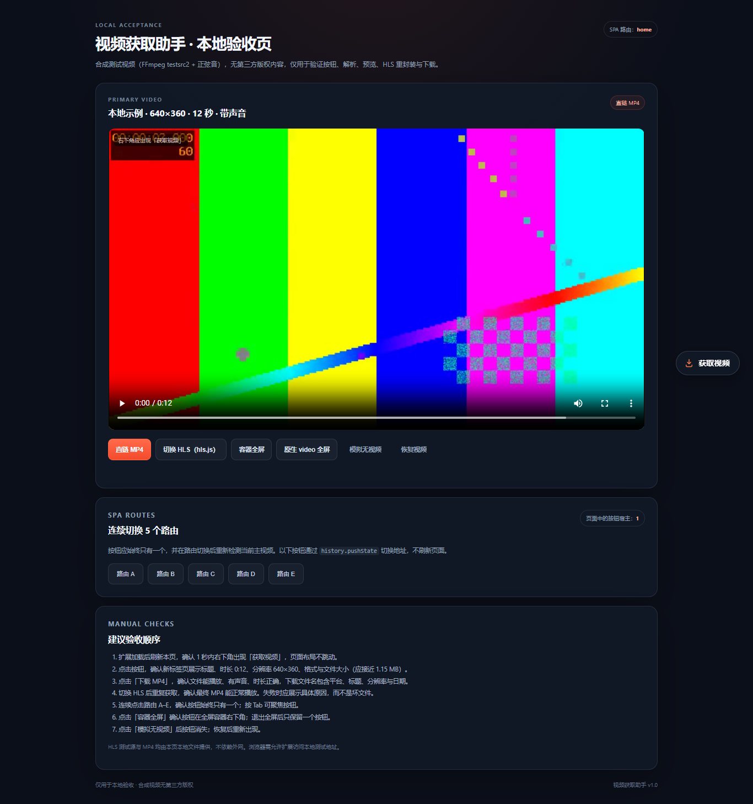
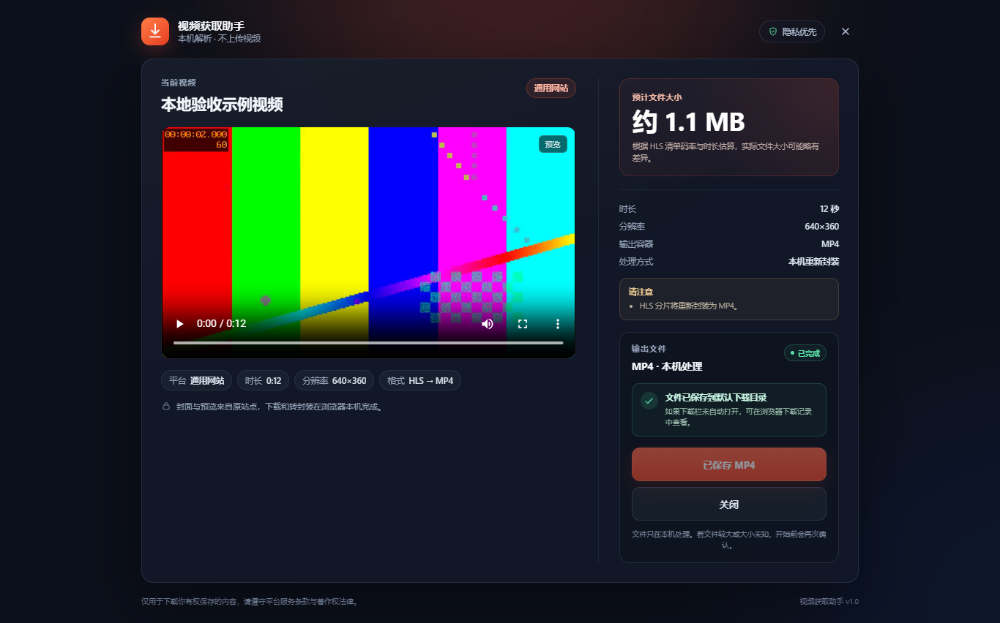
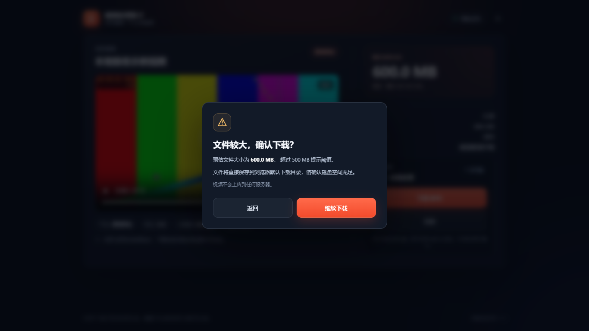

# 视频获取助手

一款基于 **Manifest V3** 的 Microsoft Edge 扩展（兼容 Chrome）。在含有 HTML5 视频的页面右下角注入「获取视频」按钮，点击后解析当前主视频并打开独立预览页，确认后在**本机**下载或转封装为可播放的 MP4。

- 默认适配：抖音、快手、哔哩哔哩。
- 通用兜底：任意 HTML5 视频网页（通过可选站点权限或 `activeTab` 主动启用）。
- 媒体处理：直链 MP4、HLS、DASH 音视频分轨、WebM；ffmpeg.wasm 与 hls.js 均本地打包。
- 所有视频处理在本机完成，不上传视频、媒体地址或用户数据。
- 不处理 DRM、直播、付费/地区限制内容；不提供去水印、绕过会员或批量抓取能力。







---

## 目录

1. [功能概览](#1-功能概览)
2. [架构](#2-架构)
3. [安装、构建与加载](#3-安装构建与加载)
4. [权限说明](#4-权限说明)
5. [平台支持矩阵](#5-平台支持矩阵)
6. [下载与 MP4 处理策略](#6-下载与-mp4-处理策略)
7. [异常处理](#7-异常处理)
8. [本地验收与测试](#8-本地验收与测试)
9. [隐私与数据](#9-隐私与数据)
10. [已知限制](#10-已知限制)
11. [目录结构](#11-目录结构)
12. [新增平台适配器](#12-新增平台适配器)
13. [版权合规与第三方许可证](#13-版权合规与第三方许可证)

---

## 1. 功能概览

### 悬浮按钮

- 文字固定为「获取视频」，带下载图标；深色半透明胶囊，`44px` 高。
- 右下角 `right: 24px; bottom: 88px`，窄屏 `right: 16px`，避免遮挡播放器控制条。
- 使用 Shadow DOM 隔离全部样式，不污染宿主页面。
- 只有检测到有效、可见、非广告的 `<video>` 才创建 UI；无视频时移除整个宿主节点。
- 支持 SPA 路由（`pushState`、`replaceState`、`popstate`、DOM 变化，300ms 防抖）与全屏（`fullscreenchange`）。
- 按钮有默认 / 解析中 / 成功 / 失败状态；解析中 spinner、成功对勾、失败中文 toast。
- 支持键盘聚焦、Enter / Space 触发、`:focus-visible` 与 `prefers-reduced-motion`。
- 检测到可见登录 / 支付等关键弹窗时暂时隐藏按钮；若弹窗本身就是包含当前视频的详情/播放器，则按钮上移至 `bottom: 148px` 继续可用，避开底部关闭按钮。
- 点击工具栏扩展图标不会弹窗，而是重新扫描当前页并给出可见提示：检测到视频、没有视频，或被关键弹窗暂时遮挡。

### 视频识别

- 按“正在播放 > 可见面积 > 视口占比 > 分辨率”选择主视频，排除隐藏、过小、广告或背景装饰元素。
- 标题优先 JSON-LD / `og:title` / `twitter:title`，再退到页面标题，并清理平台后缀。
- 封面优先 `og:image`、平台封面字段、`video.poster`，加载失败显示本地占位图。
- 时长读取 `video.duration`，分辨率读取 `videoWidth/videoHeight`，不可用时回退 Open Graph。
- 对 `blob:` 地址回溯网络请求与页面清单；不能回溯时明确报错，绝不把 blob URL 当作文件下载。
- MAIN world 只读网络钩子仅记录媒体 URL，不修改、阻塞或重放页面请求，不记录 Cookie / 请求体。

### 预览页

- 由 Service Worker 创建任务并用 `chrome.tabs.create` 打开独立标签页，不使用弹窗或侧边栏。
- 任务 ID 存于 URL；刷新后从 `chrome.storage.session` 恢复。
- 任务过期或不存在时显示中文说明，而非白屏。
- 视频播放器 16:9、`controls`、`preload="metadata"`，默认不自动播放声音。
- 展示标题、平台、时长、分辨率、格式、处理方式与醒目的文件大小。
- 主按钮「下载 MP4」，次按钮「取消下载 / 关闭」；下载进度明确区分准备中、下载中、转换中、保存中、已完成、已取消、失败。
- 有真实总大小时才显示百分比；未知时显示不确定进度，不伪造百分比。
- 文件大于 500 MB 或大小未知时，使用页面内确认对话框（非原生 `confirm`）。
- 响应式支持 360–1920px；所有状态提示为中文。

### 下载与转换

- 直链单文件 MP4：`chrome.downloads.download` 由浏览器流式下载，不占扩展内存。
- HLS：解析 master / media playlist，选择 ≤1080P 的最高码率，下载分片与独立音轨，必要时 AES-128 解密，再以 ffmpeg.wasm 重新封装。
- DASH：解析 MPD（SegmentTemplate / SegmentList / BaseURL），分别下载视频轨与音频轨，在本机合并。
- 哔哩哔哩 DASH：自动配对视频与音频 `.m4s` 轨道，最终文件音频不会丢失。
- WebM：优先尝试无损封装；探测到 VP8/VP9/Opus 等不完全兼容编码时，只转码必要轨道到 H.264/AAC。
- 最终文件检查 `ftyp` 签名，并通过 ffprobe 检查音轨；失败不提供损坏文件。
- 文件名格式：`平台-标题-分辨率-日期.mp4`，过滤 `\ / : * ? " < > |` 等字符，限制长度，`conflictAction: "uniquify"` 避免覆盖。
- 支持取消下载与失败重试；取消会删除部分文件、IndexedDB 临时分片和 DNR 会话规则。
- 下载开始后关闭预览页不会中断后台任务；若在解析阶段关闭，则只保留分析，不会自动开始下载。

---

## 2. 架构

```text
┌──────────────────────────────── Page / Content ───────────────────────────────┐
│ network-hook.js (MAIN world)        content-script.js (ISOLATED)             │
│  - 只读包装 fetch / XHR              - 视频选择、平台适配器、Shadow DOM 按钮      │
│  - performance 媒体扫描              - 查询网络候选、页面 hints                   │
│  - SPA 路由广播                      - 只发送快照，不做跨域下载                    │
└───────────────────────────────────┬───────────────────────────────────────────┘
                                    │ chrome.runtime.sendMessage
┌───────────────────────────────────▼───────────────────────────────────────────┐
│ Service Worker                                                                │
│  - 创建 / 恢复 / 过期任务；storage.session                                      │
│  - 预解析与大小准备；DNR Referer 会话规则                                        │
│  - 打开预览页；启动 chrome.downloads；转发任务状态                                 │
└───────────────┬────────────────────────────────────────────┬──────────────────┘
                │                                            │
┌───────────────▼────────────────────┐      ┌────────────────▼──────────────────┐
│ Preview Page (React)               │      │ Offscreen Document                │
│  - 任务恢复 / 预览播放 / 下载操作     │      │  - HLS / DASH 解析与分片下载        │
│  - 进度、确认、错误展示              │      │  - IndexedDB 临时分片              │
│  - hls.js（本地打包）               │      │  - ffmpeg.wasm 合并 / 转码         │
└────────────────────────────────────┘      │  - Blob URL 供 downloads 使用      │
                                            └───────────────────────────────────┘
```

- **Service Worker 不执行 ffmpeg 长任务**，避免被回收；转换任务放在 offscreen document。
- **Blob / 对象 URL 只在 offscreen 中创建**；Service Worker 负责调用 `chrome.downloads`。
- **跨域媒体请求**只在 offscreen 或预览页执行，内容脚本不直接抓取媒体。
- 大文件分片临时写入 **IndexedDB**；完成后、取消后、失败后或过期后清理。
- 直链 MP4 不进入 ffmpeg，避免不必要的内存占用。
- DNR Referer 规则只在任务活动期间存在，并只匹配该任务媒体候选的域名；完成 / 取消 / 失败后立即移除。

---

## 3. 安装、构建与加载

### 环境

- Node.js **≥ 20.19**（本项目在 Node 24 上验证）
- npm 10+
- Microsoft Edge **≥ 116** 或 Google Chrome **≥ 116**
- 可选：Python + Pillow，仅用于重新生成图标

### 安装依赖

```bash
npm install
```

安装会包含本地 `@ffmpeg/core`（约 31 MB wasm）与 `hls.js`，没有 CDN 运行时依赖。

### 类型检查、单元测试、构建

```bash
npm run typecheck
npm test
npm run build
```

`npm run build` 会：

1. 运行 TypeScript 类型检查；
2. Vite 构建 Service Worker、offscreen、预览页、选项页；
3. 用 Vite library 模式构建两个 IIFE 内容脚本；
4. 将 `@ffmpeg/core` 的 `ffmpeg-core.js` 与 `ffmpeg-core.wasm` 复制到 `dist/vendor/ffmpeg/`。

构建产物在 `dist/`。其中 ffmpeg wasm 约 30.74 MB 属于正常现象。

### 在 Edge 中加载

1. 打开 `edge://extensions/`。
2. 打开「开发人员模式」。
3. 点击「加载解压缩的扩展」，选择本项目下的 **`dist`** 目录。
4. 固定工具栏图标（可选）。
5. 打开本地测试页或任一支持页面，刷新页面。

Chrome 同理：`chrome://extensions/` → 开发者模式 → 加载已解压的扩展程序。

### 常见加载问题

- **Manifest 报 CSP 错误**：请确认 `public/manifest.json` 中的 `worker-src` 只有 `'self'`；Chrome MV3 不接受其中的 `blob:`。
- **ffmpeg 转换失败**：检查 `dist/vendor/ffmpeg/ffmpeg-core.js` 和 `.wasm` 是否存在；重新执行 `npm run build`。
- **本地测试页没有按钮**：确认访问地址是 `http://localhost:4173` 或 `http://127.0.0.1:4173`，并在加载扩展后刷新页面。
- **Edge 官方发行版忽略命令行 `--load-extension`**：这是浏览器安全策略，请按上面的「加载解压缩的扩展」在 `edge://extensions` 中手动加载。

---

## 4. 权限说明

| 权限 | 用途 | 说明 |
| --- | --- | --- |
| `downloads` | 保存最终 MP4、读取字节进度、取消/重试下载 | 直链由浏览器原生流式下载；转换结果使用 offscreen 生成的 Blob URL。 |
| `storage` | `chrome.storage.session` 保存任务元数据 | 不存视频二进制；大文件分片在 IndexedDB。 |
| `scripting` | 动态注册通用网站内容脚本；工具栏 `activeTab` 注入 | 只在用户主动授权或点击扩展图标时注入。 |
| `activeTab` | 当前标签页临时授权 | 用于未启用全站权限时的按页注入；刷新后失效。 |
| `offscreen` | DOM 解析、Web Worker、Blob、ffmpeg.wasm | Service Worker 没有 DOM 且可能被回收，不能承载长任务。 |
| `declarativeNetRequest` | 为当前任务媒体域名设置临时 Referer | 仅会话规则，只针对媒体主机，任务结束/过期即清理。 |
| `alarms` | 每 5 分钟清理过期任务、临时分片和 DNR 会话规则 | 避免浏览器长期运行后的残留数据。 |
| 站点权限 | 抖音、快手、哔哩哔哩页面及其公开 CDN | 默认能力。 |
| `optional_host_permissions` | `http://*/*`、`https://*/*` | 用户在选项页主动开启通用网站支持时才申请。 |

默认站点权限还包含本地测试地址 `http://localhost/*`、`http://127.0.0.1/*` 和常见公开 CDN 域名（`douyinvod.com`、`kwaicdn.com`、`bilivideo.com` 等）。未默认注入任意网站。

> `declarativeNetRequest` 规则在扩展运行期间不修改页面，只在匹配的媒体请求上补 `Referer`。不伪造 Cookie，不读取/发送登录凭证。

---

## 5. 平台支持矩阵

| 平台 / 场景 | 页面类型 | 直链 MP4 | HLS | DASH / 音视频分轨 | DRM | 本次状态 |
| --- | --- | --- | --- | --- | --- | --- |
| 抖音 | 短视频 / 推荐流 | 支持 | 捕获后支持 | 捕获后支持 | 拒绝 | 适配器已实现；当前测试网络被验证码页拦截，未完成实机下载 |
| 快手 | 短视频 | 支持 | 支持 | 捕获后支持 | 拒绝 | 适配器已实现；当前测试网络返回风控 JSON，未完成实机下载 |
| 哔哩哔哩 | 普通视频页 | 支持 | 支持 | 支持视频+音频 `.m4s` 合并 | 拒绝 | 公开页按钮与解析已验证；未登录 + 测试环境媒体代理域名无权限，大小探测失败 |
| 通用 HTML5 视频 | 本地 / 任意网页 | 支持 | 支持 | 支持标准单 Period MPD | 拒绝 | 本地直链 / HLS / DASH / WebM 已端到端验证 |
| 直播 | HLS / DASH dynamic / 平台直播页 | — | — | — | — | 明确提示「直播流暂不支持」 |
| 付费 / 会员 / 仅登录 | — | — | — | — | — | 明确提示权限/登录原因，不伪造成功 |
| Widevine / PlayReady / SAMPLE-AES | — | — | — | — | — | 立即停止并提示受版权保护 |

### 平台说明

**哔哩哔哩**

- 优先读取页面公开的播放信息；没有 `__playinfo__` 时，从只读网络记录中按视频/音频轨道配对。音频清晰度编号 `30216/30232/30280` 等用于识别音频 `.m4s`。
- 只处理当前账号有权播放、非 DRM 的内容；不调用签名算法，不伪造 Cookie，不调用需要登录态的私有接口。
- 未登录页面的「试看 30 秒」、付费/会员内容无法获取完整媒体时，会明确给出失败原因。
- 缺少音轨时宁可终止，也不会输出无声 MP4 冒充成功。

**抖音 / 快手**

- 优先当前 `<video>` 直链；MSE/blob 场景依赖 document_start 的只读网络钩子。
- 直链 MP4 由浏览器下载；HLS/DASH 走 offscreen 转封装。
- 平台反爬验证码、登录墙或签名过期都会导致明确失败；扩展不尝试绕过。

**通用网站**

- 普通网页需要：
  - 在扩展选项页开启「通用网站自动支持」（可选全站站点权限）；或
  - 点击工具栏扩展图标，通过 `activeTab` 按页注入。
- `activeTab` 只授予当前页面，不授予第三方 CDN；跨域 HLS/DASH 分片可能因此失败，此时会显示具体网络/权限原因。

---

## 6. 下载与 MP4 处理策略

### 文件大小

1. 优先 `HEAD` 读取 `Content-Length`。
2. 失败则 `GET Range: bytes=0-0` 读取 `Content-Range`，并立即取消响应体。
3. HLS/DASH 使用清单码率 × 时长估算，标记「约」。
4. 分轨格式分别探测后求和。
5. 仍未知时显示「大小未知」并说明原因，下载前要求用户确认。

不会为了估算大小而完整下载视频。

### 处理路径

| 输入 | 路径 | 输出 |
| --- | --- | --- |
| 单文件 MP4 | `chrome.downloads.download` | 原 MP4 |
| HLS（TS / fMP4，含 AES-128） | 下载分片 → IndexedDB → ffmpeg concat / 合并 | MP4 |
| DASH 音视频分离 | 分别下载 → ffmpeg `-map 0:v -map 1:a -c copy` | 带声音 MP4 |
| WebM VP9/Opus | 尝试 copy；探测不兼容后仅转码必要轨道 | H.264/AAC MP4 |
| 其他可处理直链容器 | ffmpeg 重新封装 / 兼容转码 | MP4 |

- 最终 MP4 必须存在 `ftyp` 签名，并通过 ffprobe 检查；缺失音频时会报错而不是交付无声文件。
- 转换失败不会保留不完整 MP4 为下载结果。
- 取消或失败后清理 IndexedDB 分片、Blob URL、DNR 会话规则。
- 直链 MP4 不整段读入扩展内存；HLS/DASH/WebM 受 ffmpeg.wasm 内存模型限制，下载前显示大文件提示，硬上限约 1.2 GB。

### 文件命名

- 例：`哔哩哔哩-视频标题-1920x1080-2026-10-26.mp4`
- 过滤 Windows 非法字符、控制字符；限制总字节长度；保留中文。
- 使用 `conflictAction: "uniquify"`，同名文件自动加序号，不覆盖已有文件。

---

## 7. 异常处理

页面与预览页覆盖以下情况，并给出中文可操作提示：

| 场景 | 行为 / 提示 |
| --- | --- |
| 页面没有视频 / 只有隐藏或广告视频 | 不创建按钮；点击时提示无可用视频 |
| blob/MSE 无法回溯真实地址 | 「未能回溯到真实媒体地址，请刷新页面重新播放」 |
| DRM | 「该视频受版权保护（DRM），暂不支持下载」 |
| 直播 | 「该视频为直播流，暂不支持下载」 |
| 登录 / 会员 | 「可能需要登录或会员权限」，不获取凭证 |
| 401 / 403 / 防盗链 | 明确 HTTP 状态与可能原因 |
| 跨域 / 无媒体域名权限 | 提示跨域或媒体域名权限问题 |
| 大小未知 | 「大小未知」，下载前确认 |
| 文件过大 | 转换超过安全上限时停止并说明 |
| 编码不兼容 / 转码失败 | 显示具体失败原因，不输出损坏文件 |
| 预览播放失败 | 显示封面与提示，不影响下载流程 |
| 任务过期 / 刷新 | 友好错误页；任务 TTL 到期自动清理 |
| 取消 | 清理临时分片、部分下载、DNR 规则 |
| Service Worker 回收 | 任务在 `storage.session`，下载事件可重新唤醒 Service Worker |
| 平台改版 / 解析失败 | 提示页面结构变化或未找到媒体地址 |
| 原生 video 全屏 | 浏览器不允许网页在原生 video 顶层叠加 DOM，属于平台限制 |

---

## 8. 本地验收与测试

### 启动测试页

```bash
npm run test:page
```

打开 <http://127.0.0.1:4173>。测试页包含：

- 12 秒合成 MP4（H.264/AAC，640×360）。
- HLS 主清单 + 6 个 2 秒分片。
- DASH MPD（独立视频/音频，SegmentTimeline + SegmentTemplate）。
- 6 秒 WebM（VP9/Opus）。
- 5 个 SPA 路由、容器全屏、原生全屏、移除/恢复视频、隐藏广告视频。
- 按钮宿主数量实时显示。

测试媒体由 FFmpeg `testsrc2` + 正弦波生成，无第三方版权素材，随仓库位于 `test-site/media/`。

### 自动化

```bash
npm run typecheck   # TypeScript 0 错误
npm test            # 33 个纯函数单元测试
npm run build       # 生产构建
```

单元测试覆盖：

- 文件大小 / 时长 / 分辨率 / 进度格式化。
- 文件名清洗、保留字符、长度限制、日期与扩展名。
- M3U8 属性解析、主清单、音轨组、媒体清单、AES key、byerange、直播、SAMPLE-AES。
- 视频评分与主视频选择（播放中、可见面积、广告、隐藏、背景）。
- URL 协议白名单、脱敏、相对地址、标题清洗、ISO 时长。

### 手动验收清单

1. 打开测试页，确认 1 秒内右下角出现「获取视频」；页面布局不位移。
2. 按 Tab 可聚焦按钮，Enter / Space 可触发；焦点轮廓可见。
3. 点击按钮，新标签页展示标题、`0:12`、`640×360`、格式与约 `1.2 MB` 大小。
4. 刷新预览页，任务恢复且大小仍正确。
5. 点击「下载 MP4」，文件能播放、有声音、时长约 12 秒。
6. 切换 HLS，重复获取与下载，最终 MP4 有声音且不是 `.ts` 改后缀。
7. 切换 DASH（MPD），获取后确认显示「DASH → MP4」，下载后音视频均存在。
8. 切换 WebM，获取后下载，最终为 H.264 + AAC MP4。
9. 连续点击路由 A–E，页面中的按钮宿主始终为 1。
10. 点击「容器全屏」，按钮移动到全屏容器；退出后回到页面且只有一个按钮。
11. 点击「模拟无视频」，按钮消失；恢复视频后重新出现。
12. 下载中点击「取消下载」，确认已取消状态、下载目录无残留、随后「重新下载」可成功。
13. 在预览页把窗口缩到 360px 和放大到 1920px，无横向滚动，按钮不重叠。
14. 人为使任务过期（或等待 TTL）后刷新，显示「任务已过期」友好页面。

### 本次实测结果

验证环境：**Microsoft Edge 156.0.4314.42（Windows，Headless 新无头模式）**，通过 Chromium 扩展调试协议加载 `dist`。

| 项目 | 结果 |
| --- | --- |
| `tsc --noEmit` | 通过，0 错误 |
| Vitest | **33 / 33 通过** |
| 生产构建 | 通过；产物含本地 ffmpeg wasm |
| Edge 加载 `dist` | 成功，无 manifest / CSP 错误 |
| 按钮注入 / 位置 / 键盘 | 通过；从导航到可见按钮实测 **205ms**；一键、右下角、Enter 打开预览 |
| 5 次 SPA 切换 | 宿主始终为 1 |
| 容器全屏 | 宿主移动到 `fullscreenElement`，数量 1 |
| 预览刷新恢复 | 通过 |
| 过期任务 | 通过；显示「任务已过期」，任务、DNR 规则、offscreen 均清理 |
| 直链 MP4 | 通过；实际大小 1,209,746 字节，页面显示 1.2 MB，误差 < 1% |
| HLS → MP4 | 通过；ffprobe：H.264 + AAC，12.36s，1,032,631 字节 |
| DASH 分轨 → MP4 | 通过；ffprobe：H.264 + AAC，12.10s，1,209,782 字节 |
| WebM → MP4 | 通过；ffprobe：H.264 + AAC，6.08s，498,770 字节 |
| 取消 / 重试 | 通过；取消后下载目录为空、临时规则 0，重试成功 |
| 500 MB 确认 | 通过；模拟 600 MB 后打开页面内对话框，Esc 可关闭 |
| 360 / 1366 / 1920 布局 | 通过；无横向滚动；360px 主按钮全宽 |
| 本地页面控制台 | 无未处理异常、无 404 |
| 哔哩哔哩 | 公开页按钮与 DASH 解析通过；当前环境媒体经 Edge 测试代理域名转发，未授予该代理域名权限，大小未知且预览加载失败；未下载内容 |
| 抖音 / 快手 | 当前网络分别被验证码页 / 风控 JSON 拦截，未能完成登录态实机下载验证 |

> **下载文件名验证说明**：自动化浏览器通过 CDP 接管下载目录时会把最终文件重命名为随机 GUID / URL 文件名，因此自动化环境里看到的磁盘文件名不代表扩展建议名。任务记录中的建议文件名已验证为 `通用网站-本地验收示例视频-640x360-2026-10-26.mp4`；正式 Edge 手动下载时由 `chrome.downloads.download({ filename })` 使用该名称，请在下载栏复核。

---

## 9. 隐私与数据

- 所有解析、下载、转封装均在用户设备上完成；没有上传接口，也没有统计埋点。
- `chrome.storage.session` 保存任务元数据（标题、候选 URL、状态），关闭浏览器会话后失效。
- 大文件分片临时存于 IndexedDB `vva-media-cache`，数据库最大保留 2 小时；任务完成、取消、失败或过期时主动清理。
- Blob 对象 URL 只存在于 offscreen 文档，下载完成后立即 `revokeObjectURL`。
- 日志中完整媒体 URL 会被脱敏为 `[已脱敏链接]`；不打印 Cookie、Authorization 或请求体。
- 网络钩子只保留最多 60 条媒体 URL，不做持久化，不记录无关请求。
- 内容脚本读取的页面数据只用于生成当前视频快照。

---

## 10. 已知限制

1. **DRM 不支持**：Widevine / PlayReady / FairPlay / SAMPLE-AES 等一律停止。
2. **直播不支持**：HLS 无 `#EXT-X-ENDLIST`、DASH `type="dynamic"`、平台直播页都会提示。
3. **DASH 多 Period 不支持**：单 Period 是当前支持范围；多 Period 会返回明确失败。
4. **HLS / DASH 自动选择上限 1080P**：为控制本机内存，选择不超过 1080P 的最高可用轨道。
5. **ffmpeg.wasm 内存限制**：转封装路径默认硬上限约 1.2 GB；超过 500 MB 或大小未知会先确认。直链 MP4 由浏览器流式下载，不受此内存限制。
6. **原生 `<video>` 全屏**：浏览器不允许在原生视频全屏顶层叠加扩展 DOM；自定义播放器容器全屏正常。按钮仍会挂到 `fullscreenElement`，但原生视频全屏下不可见，这是浏览器安全边界。
7. **跨域 iframe 视频**：内容脚本默认只运行在顶层页面（`all_frames: false`），不支持仅存在于跨域 iframe 中的视频。
8. **通用网站权限**：未开启可选全站权限时，`activeTab` 不覆盖第三方媒体 CDN；HLS/DASH 可能因媒体域名权限失败，会显示具体原因。
9. **防盗链**：DNR 只覆盖候选媒体主机；若 HLS/DASH 的分片跳转到未声明的新 CDN，可能仍需相应站点权限。
10. **平台页面变化**：抖音、快手、B 站会改动 DOM 与播放器；适配器已尽量用通用探测，但仍可能失效。失败会明确提示，不会崩溃或误报成功。
11. **登录态 / 签名过期**：媒体签名 URL 有时效；长时间停留预览页后下载可能 403，需要重新获取。
12. **平台实机验证**：本次环境对抖音/快手触发验证码/风控；B 站测试媒体的代理域名未被授予权限。因此这两个平台/该网络下的完整下载仍需在正常网络和登录账号下复核，详见支持矩阵。
13. **文件名自动化验证**：CDP 下载行为会覆盖文件名；建议手动验收下载栏文件名。

---

## 11. 目录结构

```text
.
├─ public/
│  ├─ manifest.json
│  ├─ icons/{icon16,icon32,icon48,icon128}.png
│  └─ assets/cover-placeholder.svg
├─ scripts/
│  ├─ build.mjs                 # 主构建 + IIFE 内容脚本 + ffmpeg 资源复制
│  └─ generate-icons.py         # 可选：Pillow 重新生成图标
├─ src/
│  ├─ background/
│  │  ├─ service-worker.ts      # 任务、消息、下载、生命周期
│  │  ├─ task-store.ts          # chrome.storage.session
│  │  ├─ dnr.ts                 # 临时 Referer 会话规则
│  │  └─ offscreen.ts           # offscreen 生命周期与消息
│  ├─ content/
│  │  ├─ network-hook.ts        # MAIN world 只读网络/路由钩子
│  │  ├─ page-bridge.ts         # 跨 world 事件桥
│  │  ├─ content-script.ts      # 按钮与解析控制器
│  │  ├─ fetch-button.ts        # Shadow DOM UI
│  │  ├─ video-probe.ts         # 主视频/广告/弹窗检测
│  │  ├─ metadata.ts            # 标题/封面/时长/DRM
│  │  └─ adapters/              # douyin / kuaishou / bilibili / generic
│  ├─ offscreen/
│  │  ├─ main.ts                # 分析、下载、转换任务
│  │  ├─ hls.ts                 # playlist 解析下载 + AES-128
│  │  ├─ dash.ts                # MPD 分片下载
│  │  ├─ temp-store.ts          # IndexedDB 临时分片
│  │  ├─ ffmpeg-runner.ts       # ffmpeg.wasm 加载与执行
│  │  ├─ convert.ts             # 合并/转码/音轨校验
│  │  └─ bytes.ts / fetch-utils.ts
│  ├─ preview/
│  │  ├─ App.tsx
│  │  ├─ useTask.ts
│  │  ├─ components/{VideoPlayer,DownloadPanel,ConfirmLargeDialog}.tsx
│  │  └─ styles.css
│  ├─ options/                  # 通用网站授权、权限与支持说明
│  └─ shared/                   # 类型、消息、URL、文件名、M3U8、DASH、格式化、测试纯函数
├─ test-site/                   # 本地验收页 + 合成媒体（MP4/HLS/DASH/WebM）
├─ tests/                       # Vitest 纯函数测试
├─ docs/screenshots/            # 验收截图
├─ vite.config.ts
├─ vite.testpage.config.ts
├─ vitest.config.ts
├─ tsconfig.json
└─ README.md
```

---

## 12. 新增平台适配器

1. 在 `src/content/adapters/` 新建适配器，实现 `PlatformAdapter`：

```ts
interface PlatformAdapter {
  id: PlatformId;
  name: string;
  matches(url: string): boolean;
  collect(context: AdapterContext): Promise<AdapterResult>;
  getRequestHeaders?(context: AdapterContext): Record<string, string>; // 仅允许 Referer
}
```

2. 在 `src/content/adapters/index.ts` 注册；在 `src/shared/types.ts` 增加 `PlatformId` 与展示名。
3. 在 `public/manifest.json` 增加页面与必要 CDN 的 `host_permissions`、`content_scripts.matches`。
4. 优先复用 `finalizeResult()`，把平台特性（标题、音轨配对、DRM/live 判定）作为参数或 `extraCandidates`。
5. 不要引入签名算法、私有密钥、去水印或绕过 DRM/会员的逻辑。
6. 为纯函数补测试；平台 DOM 选择器只作为兜底，不要堆叠脆弱 CSS。
7. 保持 `getRequestHeaders` 只返回 Referer；Cookie 由浏览器按同源上下文自动处理，扩展不读取。

---

## 13. 版权合规与第三方许可证

**仅处理你拥有权利或已获授权保存的内容。** 请遵守视频平台服务条款、著作权法及当地法律。本项目：

- 不提供去水印、付费内容破解、地区限制绕过、DRM 绕过、批量抓取。
- 不伪造 Cookie、不窃取登录凭证。
- 对直播、DRM、登录/会员限制明确报错。
- 仅支持当前账号可正常播放的公开、非 DRM 内容。

### 第三方依赖

| 依赖 | 版本 | 许可证 |
| --- | --- | --- |
| `@ffmpeg/ffmpeg` | 0.12.15 | MIT |
| `@ffmpeg/core` | 0.12.10 | **GPL-2.0-or-later** |
| `hls.js` | 1.7.3 | Apache-2.0 |
| `react` / `react-dom` | 19.3.1 | MIT |
| `vite` / `vitest` / `typescript` | 构建工具 | MIT / Apache-2.0 |

`@ffmpeg/core` 以 GPL-2.0-or-later 分发，并包含 libx264 等组件。**如果你将构建产物对外分发，必须一并遵守 GPL 的相应义务（包括提供对应源代码/许可证信息）**，并自行确认 FFmpeg 构建配置与平台政策。本仓库不改变任何第三方许可证。

本地测试媒体由 FFmpeg 的 `testsrc2` 与正弦波合成，不含第三方影视素材。B 站公开页仅用于验证适配器解析失败/成功提示，本次未下载受版权保护内容。

